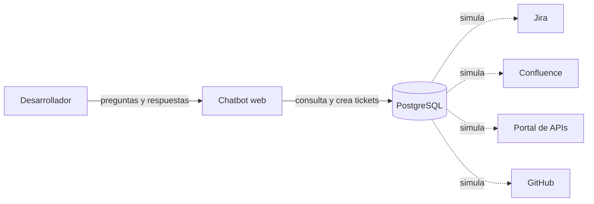
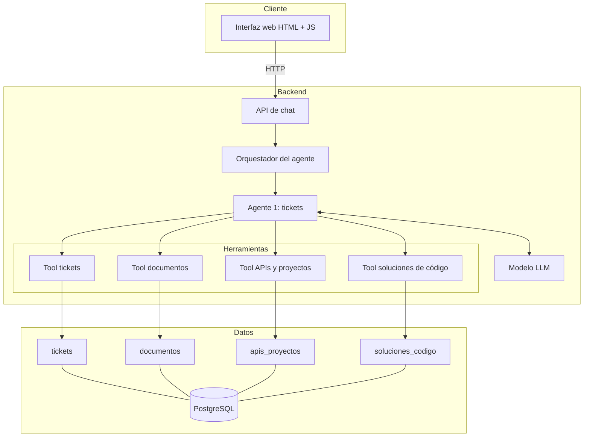
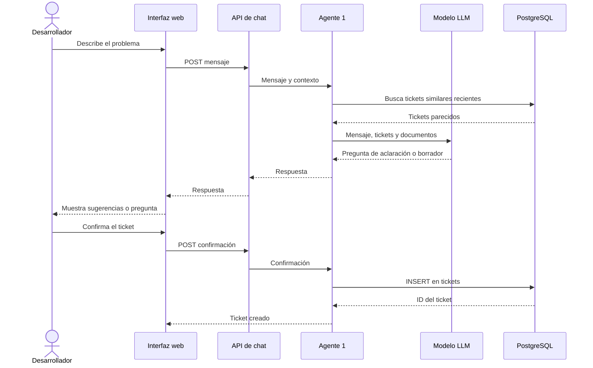

# SPEC 00 — Diagrama de arquitectura de la solución

> **Status:** Approved
> **Depends on:** ninguna
> **Date:** 2026-11-13
> **Objective:** Documentar en diagramas la arquitectura completa del MVP del chatbot de tickets, de la interfaz web hasta la base de datos PostgreSQL simulada.

## Por qué existe esta spec

El README pide definir la arquitectura antes de construir. Las specs 01 a 05 se apoyan en esta vista común. Así cada una sabe qué componente construye y con quién se conecta.

## Alcance

**Dentro:**

- Diagrama de contexto: usuario, chatbot y fuentes de información simuladas.
- Diagrama de componentes: interfaz web, backend, agentes, capa de acceso a datos y PostgreSQL.
- Diagrama de secuencia del Agente 1 (consulta de tickets similares y creación de ticket).
- Tabla de responsabilidad de cada componente y la spec que lo implementa.

**Fuera de alcance (para otras specs):**

- Código, esquema SQL y datos semilla (SPEC 01).
- Elección de stack del backend y del LLM (pendiente, ver Decisiones).
- Agente 2 de aprovisionamiento (posterior al MVP).
- Integración con Jira, Confluence, Portal de APIs y GitHub reales.
- Autenticación y autorización de usuarios.

## Diagrama de contexto

## Diagrama de componentes

## Diagrama de secuencia del Agente 1

## Responsabilidad por componente

| Componente              | Responsabilidad                                                          | Spec          |
| ----------------------- | ------------------------------------------------------------------------ | ------------- |
| PostgreSQL              | Guardar tablas que simulan Jira, Confluence, Portal de APIs y GitHub     | 01            |
| API de chat             | Recibir mensajes de la UI y devolver respuestas                          | 02            |
| Orquestador del agente  | Enrutar cada mensaje al agente correcto y mantener el contexto           | 02            |
| Interfaz web            | Mostrar el chat estilo Claude y enviar mensajes a la API                 | 03            |
| Tool tickets (lectura)  | Buscar tickets recientes similares a la consulta                         | 04            |
| Agente 1                | Conducir preguntas y respuestas y crear el ticket con los 6 campos       | 05            |
| Tools documentos, APIs, código | Aportar contexto de Confluence, Portal de APIs y GitHub simulados | 02, 04, 05    |

Los 6 campos del ticket son: detalle del problema, equipo responsable, evidencias, aplicativo, ambiente (certificación o producción) y detalle de la solución.

## Modelo de datos

Esta spec no introduce estructuras de datos nuevas. Las cuatro tablas del diagrama (`tickets`, `documentos`, `apis_proyectos`, `soluciones_codigo`) son nombres lógicos. La SPEC 01 define sus nombres y columnas finales.

## Plan de implementación

1. Crear `specs/00-arquitectura-solucion.md` con los diagramas de contexto y de componentes.
2. Agregar el diagrama de secuencia del Agente 1.
3. Agregar la tabla de responsabilidad por componente y spec.
4. Abrir el archivo en GitHub o en un visor Mermaid y confirmar que los tres diagramas se renderizan.

## Criterios de aceptación

- [ ] El archivo contiene exactamente tres diagramas Mermaid: contexto, componentes y secuencia.
- [ ] Los tres diagramas se renderizan sin errores en GitHub.
- [ ] Las cuatro fuentes del README (Jira, Confluence, Portal de APIs, GitHub) aparecen en el diagrama de contexto.
- [ ] Ningún diagrama muestra una conexión a una plataforma real.
- [ ] Cada componente de la tabla indica la spec que lo implementa.
- [ ] El diagrama de secuencia incluye la búsqueda de tickets similares y la creación del ticket.

## Decisiones

- **Sí:** PostgreSQL como única fuente de datos del MVP. Lo define el README y evita depender de credenciales reales.
- **Sí:** Mermaid para los diagramas. GitHub lo renderiza y vive en el mismo repositorio.
- **Sí:** una tool por fuente de datos. Permite reemplazar la tabla simulada por la integración real sin tocar el agente.
- **No:** integraciones reales en el MVP. Se difieren a otras specs.
- **No:** Agente 2 en el diagrama. Queda fuera del MVP.
- **Pendiente:** stack del backend y proveedor del LLM. Sin decisión del equipo, el diagrama usa nombres genéricos. Se resuelve antes de la SPEC 02.

## Riesgos

| Riesgo                                                 | Mitigación                                                             |
| ------------------------------------------------------ | ---------------------------------------------------------------------- |
| Los nombres de tablas cambian en la SPEC 01            | Actualizar este diagrama al aprobar la SPEC 01                         |
| El stack elegido no encaja con la capa de herramientas | Validar el diagrama contra el stack antes de aprobar la SPEC 02        |
| Mermaid no se renderiza en algún visor                 | Mantener sintaxis estándar y revisar en GitHub                         |

## Lo que **no** está en esta spec

- Código, SQL o datos semilla.
- Elección de stack o de LLM.
- Agente 2 de aprovisionamiento.
- Integraciones reales con Jira, Confluence, Portal de APIs y GitHub.
- Autenticación de usuarios.
